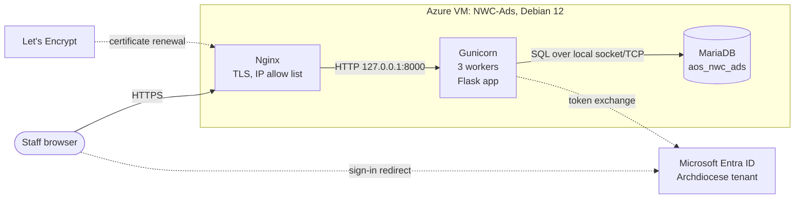
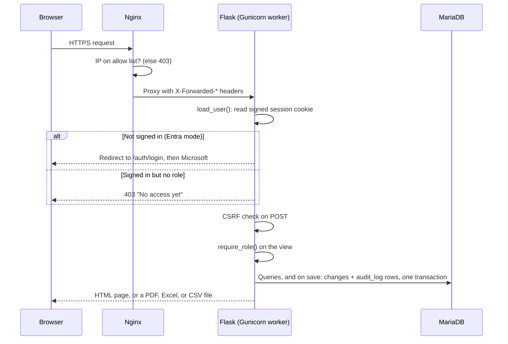
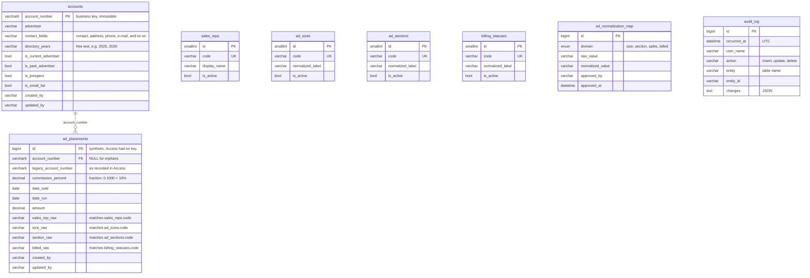

# NWC Ads: System Architecture

Copyright 2026 Archdiocese of Seattle. Author: Kevin F Benz.

This document describes how NWC Ads is built: its purpose, its components, its data, and the design decisions behind them. Read it before changing the system.

| Related documents | Purpose |
|---|---|
| [developer-guide.md](developer-guide.md) | Setting up a workstation and making changes, with step-by-step recipes |
| [operations.md](operations.md) | Running the production server: deploy, configure, back up, troubleshoot |
| [backlog.md](backlog.md) | Open work, known issues, and future ideas |
| [access_application_spec.md](access_application_spec.md) | Analysis of the Access database that NWC Ads replaces |
| [../decisions.md](../decisions.md) | Decision log |

## 1. Purpose and scope

NWC Ads is the advertising database for *Northwest Catholic*, the magazine of the Archdiocese of Seattle. It replaces a Microsoft Access database (`NWC_ADV_DB_2015.accdb`) that staff used for about 25 years.

It manages three things:

1. **Accounts**: advertisers, prospects, and mailing-list contacts, identified by a six-character account number.
2. **Ad placements**: each ad sold, with its sell date, run date, price, commission, size, section, and sales rep.
3. **Outputs**: commission and publication reports, mailing labels, advertiser lists, and Excel exports.

Every Access form, report, and Dashboard export has a web equivalent. [access_application_spec.md](access_application_spec.md) maps each Access object to its source.

The system is internal: a small number of Northwest Catholic staff use it from Archdiocese networks. It holds about 830 accounts and 11,900 ads, so performance and scale are not design drivers. Data correctness, auditability, and ease of maintenance are.

## 2. System context



| Element | Role |
|---|---|
| **Nginx** | Terminates TLS, redirects HTTP to HTTPS, admits only allow-listed IP addresses, and proxies to Gunicorn. |
| **Gunicorn** | Runs the Flask application with three worker processes, managed by systemd (`aosnwcads.service`). |
| **Flask application** | All business logic, pages, reports, and file generation (PDF, Excel, CSV). |
| **MariaDB** | The system of record. Runs on the same VM. |
| **Microsoft Entra ID** | Signs users in and supplies their role. NWC Ads stores no passwords. |

There are no other integrations. NWC Ads sends no e-mail and calls no other APIs.

## 3. Technology stack

| Layer | Technology | Notes |
|---|---|---|
| Language | Python 3.11 | The Debian 12 system Python on the VM. Use 3.11 or later on workstations. |
| Web framework | Flask 3.1 | Blueprints, one per functional area. |
| Database access | SQLAlchemy 2 with Flask-SQLAlchemy 3.1 | ORM models in `app/target_models.py`. |
| Schema changes | Alembic, through Flask-Migrate | Revisions in `migrations/versions/`. |
| Forms and CSRF | Flask-WTF and WTForms | Every POST carries a CSRF token. |
| Sign-in | MSAL for Python | OpenID Connect authorization code flow. |
| Database driver | PyMySQL | Pure Python, so no compiler is needed. |
| PDF | ReportLab | Avery 5160 mailing labels. |
| Excel | openpyxl | Exports and address lists. |
| Templates | Jinja2 | Server-rendered HTML; almost no JavaScript. |
| Web server | Gunicorn behind Nginx | See [operations.md](operations.md). |

The pages are plain server-rendered HTML. There is no JavaScript framework and no build step. This keeps the system maintainable by one developer.

## 4. Components

### 4.1 Source layout

```
config.py                 Settings, read from environment variables (.env)
wsgi.py, run.py           Entry points (Gunicorn uses wsgi:app; flask CLI uses run.py)
app/
  __init__.py             Application factory: create_app()
  extensions.py           Shared db and migrate objects
  auth.py                 Sign-in, sessions, roles, require_role()
  menu.py                 Main menu definition, filtered by role
  audit.py                Audit trail (session event listeners) and the AuditLog model
  locking.py              row_version(): detects edits by two people at once
  target_models.py        Database models
  forms.py                AccountForm and AdForm (fields and validation)
  routes.py               "main" blueprint: Ads list, ad view, add/edit/delete ad, /healthz
  accounts.py             "accounts" blueprint: list, create, view/edit, delete
  search.py               "search" blueprint: advanced search and its exports
  reports.py              "reports" blueprint: the five reports
  labels.py               Mailing-label PDF layout (Avery 5160)
  spreadsheets.py         CSV and Excel responses, with formula-injection protection
  lookups.py              Lookup-list definitions and exact-text helpers
  admin.py                "admin" blueprint: audit log page, orphan ads
  admin_lists.py          Admin routes: lookup lists and merge spellings
  help.py                 "help" blueprint: in-app help topics and search
  templates/              Jinja templates, one folder per blueprint
    help/topics/          In-app help content, one HTML file per topic
  static/styles.css       The only stylesheet
migrations/               Alembic environment and revisions
sql/                      Schema, Access import, and normalization seed SQL
scripts/                  Access export and profiling (PowerShell), local preview (Python)
analysis/                 Profiling output from the Access data
deploy/                   systemd and Nginx templates
tests/smoke_test.py       Automated checks (about 260)
docs/                     This documentation
```

### 4.2 Application factory

`create_app()` in `app/__init__.py` builds the application in this order:

1. Loads `Config`, and wraps the app in `ProxyFix`, so that redirects use the `https` scheme and host that Nginx received.
2. Calls `validate_config()`. The app **refuses to start** if `AUTH_MODE` is unknown, or if Entra mode lacks its IDs or still uses the default `SECRET_KEY`.
3. Initializes the database, migrations, and CSRF protection.
4. Imports the models and registers the audit listeners (`init_audit()`).
5. Registers the blueprints: `auth`, `main`, `accounts`, `search`, `reports`, `admin`, and `help`.
6. Registers a context processor that gives every template `menu`, `help_url`, `auth_mode`, and `today`.
7. Registers the 403 and 404 error pages.

### 4.3 Blueprints and URLs

| Blueprint | URL prefix | Minimum role | Contents |
|---|---|---|---|
| `auth` | `/auth` | Public | `login`, `callback`, `logout`, `signed-out`, `frontchannel-logout` |
| `main` | `/` | Viewer | Ads list; ad view. Editor: add and edit ads. Admin: delete. Public: `/healthz`. |
| `accounts` | `/accounts` | Viewer | List and view. Editor: create and edit. Admin: delete (only without ads). |
| `search` | `/search` | Viewer | Advanced search; CSV, Excel, and label exports |
| `reports` | `/reports` | Viewer | `commission`, `publication`, `labels`, `advertiser-lists`, `exports` |
| `admin` | `/admin` | Admin | `audit`, `orphans`, `lookups`, `normalization` |
| `help` | `/help` | Viewer (Admin topics: Admin) | Help index, search, and topics |

### 4.4 Request lifecycle



## 5. Authentication and authorization

### 5.1 Sign-in

`AUTH_MODE` selects one of two modes:

- **`entra`** (production): `/auth/login` starts the OpenID Connect authorization code flow with MSAL. Microsoft redirects back to `/auth/callback`. The app checks the `state` value, exchanges the code, and reads the ID token claims. It keeps only `oid`, `name`, `preferred_username`, and the highest role, in the Flask session.
- **`dev`**: there is no sign-in. Every request runs as `DEV_USER_NAME` with `DEV_ROLE`, and a yellow banner warns that sign-in is off. Use it only on a workstation, or on a server that the IP allow list protects.

The session is a **signed cookie** (`SECRET_KEY`). It is `HttpOnly`, `SameSite=Lax`, `Secure` in Entra mode, and expires after **8 hours**. The server keeps no session state, so restarting the service does not sign anyone out.

Sign-out clears the session and sends the browser to Microsoft's logout page, which returns to `/auth/signed-out`. Microsoft can also call `/auth/frontchannel-logout` when the user signs out elsewhere.

Login only redirects to a local path (`_safe_next`), which prevents open redirects.

### 5.2 Roles

Roles are **Entra app roles** on the NWC Ads app registration. IT assigns them to people or groups in Entra:

| Entra app role | Level | Can |
|---|---|---|
| `NWCAds.Viewer` | 1 | Read everything; run all reports and exports |
| `NWCAds.Editor` | 2 | Viewer, plus create and edit accounts and ads |
| `NWCAds.Admin` | 3 | Editor, plus deletes, lookup lists, merges, orphans, audit log |

A user with several roles gets the highest. A user with none signs in but sees only "No access yet".

The app reads roles **only at sign-in**. A role change in Entra takes effect at the user's next sign-in, or after the 8-hour session expires.

In code, `g.user` is a `CurrentUser` with `can(role)`. Views use the decorator `@require_role("Editor")`. Templates hide controls with ``. **Hiding a button is never the protection.** The decorator on the view enforces it, and the tests check that a Viewer's POST receives 403.

## 6. Data model

### 6.1 Tables



The current schema is `sql/001_target_schema.sql` (the frozen baseline) plus the migrations in `migrations/versions/`; for example, `0003` adds the accounts' billing address (`billing_address1`, `billing_address2`, `billing_city`, `billing_state_code`, `billing_postal_code`). `app/target_models.py` always reflects the current schema. The `ads` table and `app/models.py` are leftovers from the project template and are unused (see the backlog).

### 6.2 Data rules and their reasons

| Rule | Reason |
|---|---|
| `account_number` is the primary key and **cannot change** in the app. | Staff, invoices, and the Access history use it as the advertiser's identity. |
| New account numbers default to the next number, zero-padded to six digits. | Matches the Access practice. |
| Every ad keeps `legacy_account_number` and has a nullable `account_number`. | 439 ads in Access refer to account numbers that do not exist. They are imported as **orphans** (`account_number` NULL) instead of being dropped, and an Admin attaches them later. |
| The foreign key uses `ON DELETE SET NULL`, but the app refuses to delete an account that has ads. | The database rule is a safety net; the app rule prevents accidental orphaning. |
| `commission_percent` stores a **fraction** (`0.1000`); the forms show and accept a **percentage** (`10`). | Access stored fractions. The conversion happens in `routes.py` (`_fraction_to_pct`, `_apply_ad_form`). |
| Dates must fall between 1990 and 2100. | Catches Access-era typos such as year 0202. |
| Sales, Size, Section, and Billed are stored as **text** (`*_raw`), not as foreign keys to the lookup tables. | Access stored free text with hundreds of spellings. Keeping text preserves history exactly. The lookup lists restrict **new** entries, and merges clean up old ones gradually. See 6.3. |

### 6.3 Lookup lists and normalization

Access allowed any text in Sales, Size, Section, and Billed, which produced variants such as `KH`, `Kh`, and `kh`, or about 830 spellings of sizes. The design cleans this up gradually and without losing history:

1. **Merge spellings** (`/admin/normalization`): an Admin ticks variants and chooses the value to keep. The app updates each affected ad **through the ORM**, so each change gets its own audit row. It records the decision in `ad_normalization_map`.
2. **Lookup lists** (`/admin/lookups`): an Admin defines the allowed codes for each field. When a list has active entries, the ad form shows a dropdown for that field, and the server rejects other values (`_lookup_values_ok` in `routes.py`). An older ad keeps its non-list value, shown as "(legacy)", until someone changes it.
3. While a list is empty, its field stays free text with suggestions. Each list can therefore go live independently.

`app/lookups.py` holds the single table (`LOOKUPS`) that drives the list pages, the merge pages, and the ad form. Adding a list there makes it appear everywhere.

**Case sensitivity.** MariaDB's default collation (`utf8mb4_unicode_ci`) treats `KH` and `kh` as equal. Normally that is convenient, but it hides the spelling variants this feature exists to fix. `lookups.exact(column)` therefore applies `COLLATE utf8mb4_bin` wherever an exact comparison matters. Lookup codes are unique **regardless of case**, which the database's unique keys also enforce.

## 7. Cross-cutting mechanisms

### 7.1 Audit trail (`app/audit.py`)

Any model with `__audited__ = True` is audited automatically. Currently that covers all seven business tables: accounts, ads, the four lookup lists, and the normalization map.

- **Before each flush**, the listener stamps `created_by` and `updated_by` with the signed-in user's username.
- **After each flush**, it writes one `audit_log` row per inserted, updated, or deleted object, **in the same transaction**. An update row lists only the fields that changed, as `[old, new]`. A delete row holds a snapshot of the record. An update that changes nothing writes no row.
- Changes made outside a request, such as from the Flask shell, are attributed to `system`.

As a consequence, **every data change must go through the ORM** in order to be audited. A bulk `UPDATE` statement (`session.execute(update(...))`) or raw SQL bypasses the listeners. The merge feature deliberately loads and updates each ad as an object for this reason.

### 7.2 Edits by two people at once (`app/locking.py`)

Each edit form carries a hidden `version`: a SHA-256 hash of the record's current values (`row_version`). When the form is saved, the server recomputes the hash. If the hash has changed, someone else saved first. The server then refuses to save, reloads the record with the other person's changes, and asks the user to re-enter theirs.

A content hash is used instead of `updated_at`, because the timestamp has one-second resolution and missed edits made within the same second.

### 7.3 Menu and in-app help

`app/menu.py` defines the menu as data: label, endpoint, minimum role, and children. The menu hides items above the user's role and marks the current section. An item whose endpoint does not exist yet shows as "soon", so the menu can be complete before every page is.

`app/help.py` lists the help topics (`TOPICS`) and maps each screen's endpoint to a topic and section (`SCREEN_HELP`). The **Help** link in the header uses that map. The topic text is plain HTML in `app/templates/help/topics/`.

### 7.4 Files: PDF, Excel, and CSV

- `labels.py` lays out Avery 5160 labels (3 × 10, 1" × 2⅝") with ReportLab. It supports a "start at label" position for partly used sheets.
- `spreadsheets.py` builds Excel and CSV downloads. Text that begins with `=`, `+`, `-`, `@`, a tab, or a carriage return gets a leading apostrophe, so that a value typed into the database cannot run as a spreadsheet formula. CSV files include a UTF-8 byte order mark, so Excel opens accented names correctly.

### 7.5 Search

`search.py` reproduces the Access advanced search. Text fields match anywhere, or use Access-style wildcards (`*` and `?`), translated to SQL `LIKE` with `/` as the escape character. **OR** mode matches any field, and **AND** mode matches all of them, with ad fields required to match the same ad. The status flags always narrow the results. The query runs over accounts `LEFT JOIN` ads and returns distinct accounts.

## 8. Security summary

| Threat | Control |
|---|---|
| Anonymous access | Nginx IP allow list; Entra sign-in for every page except `/healthz` and the sign-in pages |
| Excess privilege | Three roles; `require_role` on every changing view; tests check 403 responses |
| Cross-site request forgery | Flask-WTF CSRF token on every POST |
| Session theft | Signed, `HttpOnly`, `Secure`, `SameSite=Lax` cookie; 8-hour lifetime |
| Open redirect after sign-in | `_safe_next` allows local paths only |
| SQL injection | All queries use SQLAlchemy parameters; `LIKE` input is escaped |
| Cross-site scripting | Jinja auto-escaping; the only `|safe` output is the help content, which comes from repository templates |
| Spreadsheet formula injection | `spreadsheets.safe_text` |
| Misconfiguration | The app refuses to start in Entra mode without IDs or with the default `SECRET_KEY` |
| Undetected changes | Audit log for every data change, written in the same transaction |
| Data loss | Database backups (**not yet in place**; see the backlog) |

## 9. Known limitations

- The tests run against SQLite, not MariaDB. Case-insensitive collation and some SQL features behave differently. See "SQLite and MariaDB" in [developer-guide.md](developer-guide.md).
- Audit log times are shown in UTC.
- There is one production server and no staging environment.
- `directory_years` is free text, and the labels report matches it with "contains".

[backlog.md](backlog.md) tracks these and other open items.
