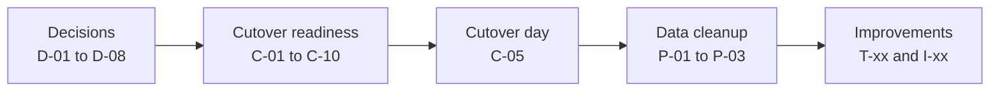

# NWC Ads: Backlog

Copyright 2026 Archdiocese of Seattle. Author: Kevin F Benz.

Last updated: 2026-11-14

This backlog lists the open work for NWC Ads: what must happen before Access is retired, the decisions the business owner needs to make, the data cleanup, technical debt, and ideas for later.

**How to use it.** Each item has an ID, an owner, a size, and a status. When an item is finished, move it to [Done](#done) with the date. When you find new work, add it to the right section with the next free ID. Do not reuse IDs.

| Size | Meaning |
|---|---|
| S | Less than a day |
| M | One to three days |
| L | More than three days |

| Owner | Meaning |
|---|---|
| Dev | The developer |
| IT | Archdiocese IT (Entra, Azure, network) |
| BO | The business owner at Northwest Catholic |

## Summary

Cutover cannot happen until **C-01** (sign-in), **C-02** (backups), **C-04** and **C-05** (a repeatable import and runbook), and **C-06** (acceptance) are done.

## 1. Cutover readiness (blocking)

| ID | Item | Owner | Size | Status |
|---|---|---|---|---|
| C-01 | **Microsoft Entra sign-in.** IT creates the app registration with the three app roles, redirect URI, and front-channel logout URL, and sends the tenant ID, client ID, and client secret ([operations.md](operations.md) section 6.1). Dev sets `AUTH_MODE=entra` and tests each role. IT assigns staff to roles, preferably through groups. | IT, Dev | S | Waiting on IT |
| C-02 | **Backups.** A nightly `mariadb-dump` with 14-day retention, Azure Backup for the VM, and a first restore test ([operations.md](operations.md) section 7). | Dev, IT | S | Proposed; not confirmed |
| C-03 | **Restrict SSH.** The network security group allows port 22 from any address. Limit it to Archdiocese addresses, or use Azure Bastion or just-in-time access. | IT | S | Open |
| C-04 | **Commit the import fixes.** Apply the three fixes made by hand on the server to `sql/002_staging_import.sql`: `'\r\n'` line endings, `ESCAPED BY ''`, and the commission range guard ([operations.md](operations.md) section 9.1). | Dev | S | Open |
| C-05 | **Cutover script and runbook.** The import is not repeatable: it overwrites account edits and duplicates ads ([operations.md](operations.md) section 9.2). Write a script that backs up, empties `ad_placements`, `accounts`, and `audit_log`, imports, and prints reconciliation figures (account count, ad count, orphan count, `SUM(amount)` per year) next to the Access figures. Rehearse it once on a copy of the database. Include a rollback plan (return to Access). | Dev | M | Open |
| C-06 | **Acceptance by the business owner.** Run each report for a recent period in both systems and compare the results. Add, edit, and search for test records. Read the in-app help and correct it. Sign off. | BO | M | Open |
| C-07 | **Business decisions D-01 to D-05** (section 2) that affect day-one behavior. | BO | S | Open |
| C-08 | **Allow-list policy after Entra.** Decide whether to keep the Nginx IP allow list once sign-in is on. Keeping it blocks staff who work from home; removing it exposes the sign-in page to the internet (Entra still protects it). | IT, BO | S | Open |
| C-09 | **Staff orientation.** A short walk-through of Accounts, Ads, Search, and Reports, pointing to Help › Getting started. Collect the staff members' Entra accounts and roles for C-01. | BO, Dev | S | Open |
| C-10 | **Certificate renewal check.** Confirm that the Nginx reload hook exists, and that `certbot renew --dry-run` succeeds with the allow list in place ([operations.md](operations.md) section 8.2). | Dev | S | Open |

## 2. Decisions needed from the business owner

| ID | Question | Why it matters | Status |
|---|---|---|---|
| D-01 | **What does "Billed" mean, and which values are valid?** | Billed exists in the data (`billed_raw`) and has a lookup list, but it is not on the ad form. The answer decides whether, and how, to add it ([developer-guide.md](developer-guide.md) recipe 4.4). | Open |
| D-02 | **What is the commission basis?** The Commission report includes ads with commission above 0%, grouped by **sell** date. The Commission export includes every ad, including 0%, by **run** date. Both copy Access. Which one does payroll use? | Avoids two "correct" commission figures. | Open |
| D-03 | **Which label stock does the office use?** The labels are laid out for Avery 5160/8160 (30 per sheet). | Wrong stock means misaligned labels. | Open |
| D-04 | **How should long names print on labels?** Some advertiser names and addresses are longer than one label line. | Decide whether to shorten, wrap, or abbreviate them. | Open |
| D-05 | **Is entering commission as a percentage (10 for 10%) acceptable?** Access stored a fraction (0.10). | Staff habits; a wrong entry gives 0.1% instead of 10%. | Open |
| D-06 | **Policy for duplicate advertisers.** How to decide that two accounts are the same advertiser, and which account number survives. | Needed before a merge-accounts feature (I-02). | Open |
| D-07 | **The approved values for Sales, Size, and Section**, including which spellings mean the same thing. | Drives the merges and lookup lists in P-01. | Open |
| D-08 | **Owners for orphan ads.** Which account each group of orphan ads belongs to, where the screen cannot suggest one. | Drives P-02. | Open |

## 3. Data cleanup (after the final import)

Do these **after** the cutover import (C-05). Changes made in NWC Ads before then are discarded by the reload. The exception is the lookup lists, which the import does not touch.

| ID | Item | Owner | Size | Status |
|---|---|---|---|---|
| P-01 | **Merge spellings and fill the lookup lists**, in this order: Sales (about 20 values), Section, then Size (about 830 spellings). Use Admin › Normalization map, then Admin › Lookup lists. | BO, Admin | L | Open |
| P-02 | **Resolve the 439 orphan ads.** Use Admin › Orphan ads: attach each group to an account, or create the missing account. | BO, Admin | M | Open |
| P-03 | **Retire Access.** Keep the final `.accdb` read-only in an archive location that OneDrive does not sync, record where it is, and remove staff shortcuts to it. | BO, IT | S | Open |

## 4. Technical debt

| ID | Item | Owner | Size | Status |
|---|---|---|---|---|
| T-01 | **Convert `tests/smoke_test.py` to pytest, and run it in GitHub Actions** on every push. | Dev | M | Open |
| T-02 | **Test data that is not real data.** The tests need the Access exports, which contain real advertiser details and are not in Git. Generate a synthetic data set, so that the tests run anywhere, including in CI. | Dev | M | Open |
| T-03 | **Run the tests against MariaDB as well as SQLite** (for example, a MariaDB service container in CI). Collation and SQL differences have caused production bugs before. | Dev | M | Open |
| T-04 | **Normalization map collapses case variants on MariaDB.** `ad_normalization_map.raw_value` uses a case-insensitive collation, so merging `kh`, `Kh`, and `kH` records one map row instead of three. The audit log still records every ad change. Fix it with a migration that sets `raw_value` to `utf8mb4_bin`, and use `lookups.exact()` in the merge lookup. | Dev | S | Open |
| T-05 | **Remove the starter model.** `app/models.py` (table `ads`) comes from the project template and is unused. Delete the file, and drop the table in a migration. | Dev | S | Open |
| T-06 | **Align `deploy/` with production.** The systemd template uses `/opt/aosnwcads` instead of `/opt/aos_nwc_ads`. The Nginx template lacks TLS, the HTTP-to-HTTPS redirect, the allow-list include, and the certificate challenge location. | Dev | S | Open |
| T-07 | **Least-privilege database account.** `nwcads` has `ALL PRIVILEGES` on the database. Give the app `SELECT, INSERT, UPDATE, DELETE`, and use a separate account for migrations. | Dev | S | Open |
| T-08 | **Monitoring.** An external uptime check on `/healthz` that alerts a shared mailbox, and an alert for application errors in the journal. | Dev, IT | S | Open |
| T-09 | **Show audit times in Pacific time** instead of UTC. | Dev | S | Open |
| T-10 | **Self-host the fonts.** Every page loads fonts from Google Fonts. Hosting them in `app/static/` removes the external dependency and the request to Google. | Dev | S | Open |
| T-11 | **Official Northwest Catholic logo** in the header, if Communications provides one and approves its use. | Dev, BO | S | Open |
| T-12 | **Dependency updates.** Turn on Dependabot (or run `pip-audit` quarterly), and keep `requirements.txt` current. | Dev | S | Open |
| T-13 | **Staging environment.** A second database on the VM, or a small second VM, for rehearsing migrations and imports before production. | Dev, IT | M | Open |
| T-14 | **License comments in templates.** Source files carry the Apache header; templates and CSS do not. Optional. | Dev | S | Open |

## 5. Ideas and enhancements

Not committed. Prioritize them with the business owner after cutover.

| ID | Idea | Notes | Size |
|---|---|---|---|
| I-01 | **Repeat an ad** for several issues at once (for example, "run this ad monthly through June"). | Staff often book series. Today, each ad is entered separately (the form pre-fills from the account's last ad). | M |
| I-02 | **Merge duplicate accounts**: move all ads to the surviving account, then delete the other. | Needs D-06. Must be audited. | M |
| I-03 | **Move an ad to a different account.** | Today, only orphan ads can be attached to an account. | S |
| I-04 | **Saved searches**: name and reuse a Search or Advertiser list query. | From the original architecture plan ("saved views"). | M |
| I-05 | **Dashboard**: sales by month, by rep, and by section; year-over-year comparison. | Read-only; low risk. | M |
| I-06 | **Billing workflow**: track invoiced and paid status. | Depends on D-01. | L |
| I-07 | **Undo a merge** from the "Recent merges" list, using the audit log. | Today, a merge is reversed by hand. | M |
| I-08 | **Structured directory years** (checkboxes per year) instead of free text. | Makes the labels report exact. Needs a data migration. | M |
| I-09 | **Foreign keys for Sales, Size, and Section**, once P-01 is complete. | Replace the `*_raw` text with references to the lookup tables. Large change; only worth doing if reporting needs it. | L |
| I-10 | **Move from Flask to FastAPI.** | Deferred by decision 10 in [decisions.md](../decisions.md). Only relevant if an API for other systems is needed. | L |

## Done

| Date | Item |
|---|---|
| 2026-11 | Azure VM, MariaDB, Gunicorn, Nginx, Let's Encrypt TLS, IP allow list |
| 2026-11 | Access data imported and reconciled exactly (accounts, ads, totals) |
| 2026-11 | Foundation: Entra sign-in code, three roles, menu, audit trail, migrations |
| 2026-11 | Accounts: list, create, edit, delete; advertising history; add, edit, and delete ads; protection against two people editing at once |
| 2026-11 | Advanced Search with OR/AND, wildcards, and Excel, CSV, and label exports |
| 2026-11 | Reports: commission, publication, mailing labels, advertiser lists, Excel exports |
| 2026-11 | Apache 2.0 license and source headers |
| 2026-11 | Northwest Catholic header, footer, and styling |
| 2026-11 | Admin: orphan ads, lookup lists, merge spellings, audit log |
| 2026-11 | In-app help, with page-specific links and search |
| 2026-11-14 | Technical documentation (architecture, developer guide, operations, backlog); tests and preview script moved into the repository |
